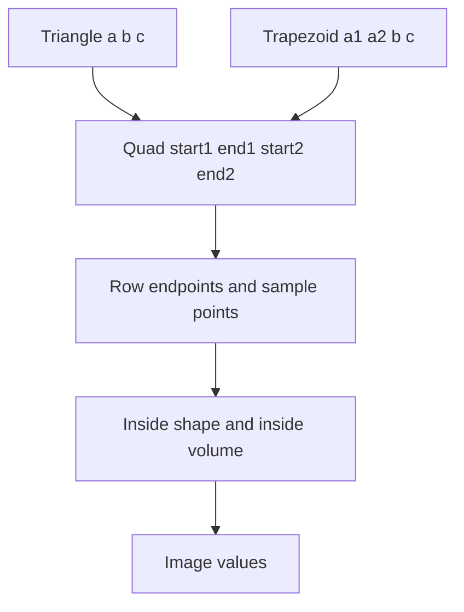

# Projection algorithm

This is the algorithm the program implements. It replaces the pseudocode on
the assignment sheet. Section 6 lists every change and why it was made.

## 1. One shape for both inputs

A triangle is a trapezoid whose two legs start at the same point.

```text
Triangle (a, b, c)        →  Quad(start1=a,  end1=b, start2=a,  end2=c)
Trapezoid (a1, a2, b, c)  →  Quad(start1=a1, end1=b, start2=a2, end2=c)
```

The projector only sees a `Quad`. It does not care which CSV shape produced it.



## 2. Geometry of one frame

Let the quad corners be `start1`, `end1`, `start2`, `end2`.

1. `L = |end1 - start1|`. The validator has already required this to equal `|end2 - start2|` within `EPS`.
2. `Dbc = |end2 - end1|`.
3. `v1 = (end1 - start1) / L` and `v2 = (end2 - start2) / L`.
4. `H = floor(L) + 1` and `W = floor(Dbc) + 1`.
5. For each row `y` in `0 .. H-1`:
   - `p1(y) = start1 + y · v1`
   - `p2(y) = start2 + y · v2`
   - `d12(y) = |p2(y) - p1(y)|`
   - If `d12(y) < EPS`, set `dp(y) = 0`. Otherwise `dp(y) = (p2(y) - p1(y)) / d12(y)`.
   - `n(y) = floor(d12(y)) + 1`
   - `offset(y) = round((Dbc - d12(y)) / 2)`
6. Pixel `(y, j)` with `j` in `0 .. W-1` has sample index `x1 = j - offset(y)`.
   - If `0 <= x1 < n(y)`, the sample point is `p1(y) + x1 · dp(y)`.
   - Otherwise the pixel is outside the shape and stays black.

`y = 0` is the row of `start1` / `start2`. For a triangle those two points are the apex, `d12` is 0, and the row stores a single sample. The `+ 1` on `H`, `W`, and `n(y)` keeps the last included index inside the length, matching an inclusive loop (`x1 <= d12` in the sheet).

Rows run along the legs. Columns run from the `end1` side toward the `end2` side, centered in a strip of width `Dbc`. The stored array is `image[y, x]`.

## 3. Sampling

Points are continuous voxel indices.

**Nearest neighbour.** The index is `floor(p + 0.5)` on each axis (half away from −∞). If that integer lies inside `M`, the value is `M` at that index. Otherwise the value is 0.

**Trilinear.** The point is inside when each coordinate lies in `[0, size - 1]`. The value is the standard weighted blend of the eight neighbouring voxels. A neighbour past the last index has weight 0 on an integer boundary, so the last voxel is well defined. Outside the closed range the value is 0. On an integer point the weight of every other corner is 0, so the result equals nearest neighbour.

The projector asks the sampler for every point, then clears pixels that are outside the shape. Out-of-volume pixels are already 0 and are marked so the normalizer cannot rescale them.

## 4. Vectorization

There is no Python loop over pixels or rows.

- `y` has shape `(H,)` and `j` has shape `(W,)`.
- `p1`, `p2`, `d12`, `dp`, `n`, and `offset` are arrays of length `H`.
- Broadcasting builds the sample coordinates as one array of shape `(H, W, 3)` in `float32`.
- A boolean mask of shape `(H, W)` marks pixels inside the shape.
- The volume is stored Fortran-contiguous, index order `[x, y, z]`, which is what `pynrrd` returns for `index_order='F'`. The linear index of voxel `(ix, iy, iz)` is

```text
ix + sx * (iy + sy * iz)
```

  because the first axis is the fastest. One indexed read (`flat[index]`) gathers nearest-neighbour values. Trilinear does eight gathers and a blend.

Geometry (the CSV points, the lengths, the validation) stays in `float64`. The sample grid is `float32`, which is exact for integer voxel coordinates well past 1024.

## 5. Cost

For one plane the time and the temporary memory are both `O(H · W)`. `H` is about the leg length and `W` is about the far-base length. The volume is not copied. Normalization looks at the volume once per run, then spends `O(H · W)` per frame. Video encoding is timed separately and is not part of the projection FPS.

## 6. Changes from the sheet's pseudocode

| Sheet | This algorithm | Why |
|---|---|---|
| `a1 = a1 + v` happens before the sample, and `y` runs while `y < Dab` | `p1(y) = start + y·v` for `y = 0 .. H-1` | The sheet never samples the row of point `a`. The apex of a triangle disappeared. |
| `E` has size `Dab * Dbc`, which is not an integer | `H = floor(L)+1`, `W = floor(Dbc)+1` | A NumPy array needs an integer shape. The extra index is the inclusive end of the loop. |
| `x = (Dbc/2) - (d12/2) + x1` used as a subscript | `offset = round((Dbc - d12) / 2)`, then column `j = offset + x1` | Subscripts are integers. Rounding centers the shorter row. |
| `for x1 = 0; x1 <= d12; x1++` | `x1 = 0 .. floor(d12)` inclusive, i.e. `n = floor(d12)+1` samples | Same inclusive iteration, with a defined integer bound. |
| `dp = (a2-a1) / d12` with no guard | If `d12 < EPS`, sample `p1` once and do not divide | The apex row has `d12 = 0`. |
| `E[x][y] = v` | `image[y, x] = v` | NumPy images are row-major. `x` is still the column. |
| Separate stories for the triangle and the trapezoid | Both become a `Quad` before projection | One implementation, and a triangle is the trapezoid `a1 = a2 = a`. |
| `v = M[p]` written as a scalar lookup | One masked gather of the whole grid | A Python loop over a `500×500` image cannot reach 30 FPS. |
| `p` outside `M` yields 0, written as a branch | Boolean mask, then the gather | Same result, no per-pixel branch in Python. |
| No interpolation specified | Nearest neighbour by default, trilinear behind the same interface | The sheet does not define `M` at a fractional index. Nearest neighbour is the fast reading; trilinear is the smooth one. |

## 7. Worked orientation

Take a rectangle in the plane `z = k`:

```text
a1 = (0, 0, k),  b = (sx-1, 0, k),  a2 = (0, sy-1, k),  c = (sx-1, sy-1, k)
```

Then `H = sx`, `W = sy`, and `image[x, y] = M[x, y, k]`. Rows follow `a1→b` (the x axis). Columns follow the far base (the y axis). A pairs-order reading of the same rectangle swaps those axes. Both readings are geometrically valid; decision 8b says which one is used.
